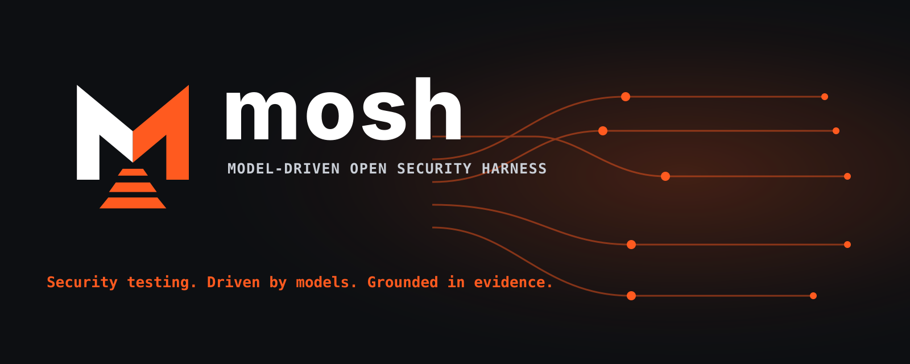

<p align="center">
  
</p>

# mosh: Model-driven Open Security Harness

Find security vulnerabilities in your applications and resolve them, using AI to simulate the tasks a security researcher runs - test live applications, source code or provide both to create more effective hypothesis and tests.

## Why do I need a harness?

Using LLMs to test the security of an application is a lot more than just pointing a model at it and letting it go. The application needs to be scoped, the tests need to be adapted to the application, the model needs tools to interact with the application under test and execution needs to be controlled, evidenced, and repeatable. `mosh` implements the harness that wraps around models to conduct deep security testing.

`mosh` simulates the core tasks a security researcher performs when testing an application:

- **Discovery:** map the application surface, passive external OSINT, routes, links, forms, JavaScript assets, third-party services, source code and observable technologies.
- **Security planning:** turn discovery evidence into scoped, testable security hypotheses that may combine live testing and source code review.
- **Test execution:** run ready tests through controlled Docker-backed tooling using explicit engagement settings.
- **Reporting:** write Markdown reports, structured event logs, and shared memory so findings are reviewable and reproducible.

When more advanced LLM models are released, you do not need to modify the harness, just configure `mosh` to use the new models instead so you can immediate benefit from new frontier model capabilities.

## Installation

0. Install these prerequisites first:

- Python 3.11 -- 3.13
- [uv](https://docs.astral.sh/uv/) (Python package manager)
- Docker

1. Clone the repository:

```bash
git clone https://github.com/llmora/mosh.git
cd mosh
```

2. Run setup:

```bash
./scripts/setup.sh
```

The setup script runs `uv sync` to install dependencies in a `.venv` virtual environment, then builds the Docker tool images.

3. Use `uv run` to execute the CLI without activating the environment:

```bash
uv run mosh https://app.example.com
```

All command examples in this README use `uv run mosh` so they work without activating the virtual environment. If you prefer to activate the environment manually, run:

```bash
source .venv/bin/activate
```

After activation, you can omit `uv run` and use `mosh ...`.

## Configuration

Set an LLM API key before running the CLI. `mosh` reads configuration from exported environment variables and from an optional `.env` file in the directory where you run the CLI. Exported environment variables take precedence over values in `.env`, and `.env` is intended for local settings only.

For the default direct DeepSeek setup, open an account at deepseek.com and generate an API key:

```bash
export DEEPSEEK_API_KEY="your-deepseek-api-key"
```

Or route through OpenRouter, open an account at openrouter.ai and generate an API key:

```bash
export OPENROUTER_API_KEY="your-openrouter-api-key"
```

To use an OpenAI-compatible endpoint such as a local Ollama `/v1` API, a LiteLLM proxy, or an internal model gateway, set:

```bash
export MOSH_LLM_BASE_URL="http://localhost:11434/v1"
# Only if the endpoint requires authentication:
export MOSH_LLM_API_KEY="your-api-key"
```

The API key is optional; mosh supplies an internal placeholder to the client library when no key is configured. Existing custom-only setups without any `custom/` model assignment continue to send every model call to this endpoint. To use the custom endpoint alongside DeepSeek or OpenRouter, assign at least one agent a `custom/` model ID in `mosh.yaml`. From then on, only `custom/` models use the custom endpoint; all other agents use their selected providers. Ensure those other providers are connected before making this change.

Instead of exporting values every time, you can create a local `.env` file:

```dotenv
DEEPSEEK_API_KEY=your-deepseek-api-key
OPENROUTER_API_KEY=your-openrouter-api-key
# MOSH_LLM_BASE_URL=http://localhost:11434/v1
# MOSH_LLM_API_KEY=your-api-key-if-needed
MOSH_MAX_DEPTH=5
MOSH_SECURITY_COMMAND_TIMEOUT=300
MOSH_REFINE_ENGAGEMENT_TEMPLATE_WITH_LLM=true
MOSH_EXTERNAL_OSINT_TIMEOUT=10
# SHODAN_API_KEY=your-shodan-api-key
# SECURITYTRAILS_API_KEY=your-securitytrails-api-key
# CENSYS_API_ID=your-censys-api-id
# CENSYS_API_SECRET=your-censys-api-secret
```

Do not commit `.env`; it is ignored by git.

### Model Selection

By default, `mosh` uses DeepSeek models to balance quality and cost. To choose different models, create `mosh.yaml` in the directory where you run the CLI and configure the models you want to run:

```yaml
models:
  discovery_live:
    crawler: deepseek/deepseek-v4-flash
    technology_mapper: deepseek/deepseek-v4-flash
    reporter: deepseek/deepseek-v4-flash

  discovery_source:
    intake: deepseek/deepseek-v4-flash
    mapper: deepseek/deepseek-v4-flash
    route_resolver: deepseek/deepseek-v4-flash
    dependency_config: deepseek/deepseek-v4-flash
    component_mapper: deepseek/deepseek-v4-flash
    gap_analyst: deepseek/deepseek-v4-flash
    reporter: deepseek/deepseek-v4-flash

  planning:
    planner: deepseek/deepseek-v4-flash
    evidence_linker: deepseek/deepseek-v4-flash
    reviewer: deepseek/deepseek-v4-pro
    reporter: deepseek/deepseek-v4-flash
    engagement_refiner: deepseek/deepseek-v4-flash

  testing:
    executor: deepseek/deepseek-v4-flash
    reviewer: deepseek/deepseek-v4-pro
    reporter: deepseek/deepseek-v4-flash

  reporting:
    writer: deepseek/deepseek-v4-flash
    reviewer: deepseek/deepseek-v4-pro

  chat:
    assistant: deepseek/deepseek-v4-flash
```

Only include the agents you want to override; omitted agents keep their defaults. For example:

```yaml
models:
  discovery_live:
    crawler: openai/gpt-5.2-mini

  discovery_source:
    mapper: openai/gpt-5.2-mini

  planning:
    evidence_linker: openai/gpt-5.2-mini
    reviewer: openai/gpt-5.2

  testing:
    reviewer: openai/gpt-5.2

  reporting:
    reviewer: openai/gpt-5.2

  chat:
    assistant: openai/gpt-5.2-mini
```

Use OpenRouter model IDs such as `openai/gpt-5.2` or `anthropic/claude-sonnet-4.5`. DeepSeek IDs such as `deepseek/deepseek-v4-flash` use `DEEPSEEK_API_KEY` directly when it is set; otherwise they route through OpenRouter and require `OPENROUTER_API_KEY`. Prefix a DeepSeek ID with `openrouter/` to use OpenRouter explicitly, even when a direct DeepSeek key is present.

For a custom OpenAI-compatible backend, configure model names exactly as that endpoint expects them. Prefix models with `custom/` when mixing providers; `mosh` strips that prefix before the call:

```yaml
models:
  discovery_live:
    crawler: custom/llama3.1
    technology_mapper: custom/llama3.1
    reporter: custom/llama3.1
```

For example, you can use `custom/llama3.1` for discovery and leave planning on the built-in DeepSeek defaults. Adding the first `custom/` assignment changes an older route-all custom setup to per-model routing, so connect DeepSeek or OpenRouter for every remaining model before doing so.

## Local web interface

Start the localhost interface from the repository directory:

```bash
uv run mosh-web
```

Open `http://127.0.0.1:8765`. The server binds only to `127.0.0.1`; `--port` changes the local port.

When required model API settings are missing, a dedicated first-run wizard checks Python/uv and Docker. If either tool image is missing and Docker is ready, it starts the image build automatically, shows progress, and offers a retry if the build fails. Continue becomes available when all environment checks are ready. The wizard then offers **Connect** for DeepSeek, OpenRouter, and a custom OpenAI-compatible endpoint; all three can be connected. Custom setup asks for its URL and an optional API key. Connect shows **Checking API**, checks access without running a model, and saves a successful connection to the local `.env` file immediately. A failed check leaves `.env` unchanged and offers Retry. **Finish setup** becomes available on the Providers screen when the saved access covers the model IDs in `mosh.yaml` (or the defaults). The check confirms API access only; it does not test the configured model IDs or generate a response.

After setup, **New assessment** opens a separate wizard for a name, one or more live URLs, local source trees, or HTTPS repository URLs, and authorization confirmation. For a local source tree, select that asset type and use **Choose folder** to browse under your home folder. The wizard confirms that local folders exist. When you add a website or repository, it briefly checks reachability and shows the result on the Review step. A failed check offers **Retry check** or **Add anyway**; assets added anyway are marked **Not verified**. The check may contact the URL you entered, but it does not start discovery. Finishing creates the same engagement and asset files as the CLI. You can later open the assessment to add or remove assets. The same folder picker and reachability check are available there. Removing an asset takes it out of future runs while leaving existing generated files on disk.

The assessment page holds assets and optional guidance. A compact stage row links Scope, Discovery, Planning, and Testing, and shows the upcoming Report stage. A running stage shows a spinner; completed stages show checkmarks. Select **Discovery** in that row, then **Start discovery** to run assets without reports. The Discovery view shows the active asset and a few meaningful steps: crawling, technology identification, and report writing for websites; file and route indexing, dependency inspection, component analysis, and report writing for source assets. The active step has a spinner, and completed steps have checkmarks. Status updates in place without reloading the page. Expand **Detailed logs** at the bottom for a timestamped, console-style event stream; select **Hide logs** to close it without leaving the page. Completed assets offer **View report**, which renders the Markdown report with headings, tables, lists, links, and code blocks; a failed run offers **Retry remaining**. The browser tab can be closed while discovery runs, but keep `mosh-web` running until it finishes.

When discovery is complete, select **Planning** in the stage row, then **Start planning**. Planning examines the discovered assets, identifies potential security issues, and turns them into testable hypotheses with checks tailored to the assessment. It writes the security test plan; tests run later. Its progress updates in place, and its **Detailed logs** panel opens and closes at the bottom of the page. **View plan** opens the rendered Markdown plan; a failed run offers **Retry planning**. If discovery or guidance changes, use **Update plan** in Planning. **Refresh discovery** remains in Discovery for rerunning existing assets after their content or discovery guidance changes. It opens a confirmation page before any run starts because current discovery reports and logs may be replaced. The stage row handles navigation between sections. After planning completes for the first time, **Continue to testing** also opens Testing; it does not start a test run. Start, Retry, and Update run work on their respective stage pages.

When planning is complete, select **Continue to testing** (or **Testing** in the stage row). Planning's tests are listed with their current status and a short, expandable status guide. **Complete** means the test has run and produced a result for the current plan. A blocker may be a missing credential, permission, target, source asset, earlier test result, or prerequisite named by the plan. For supported missing inputs, select **Add required details** on the blocked test to enter the specific credential, permission, target URL, or safe test data it needs. The form saves to Scope and returns to the test; it does not start testing. Asset and other scope blockers link to Scope for review. **Requested test information** in Scope also shows the plan's missing inputs. Hints remain optional guidance about what to examine; they do not satisfy required inputs. This preview reads the current plan and engagement settings; it does not run tests or contact assets. Select **Start testing** to run ready tests and save a report for each. As each test runs, its row shows three steps: running planned checks, reviewing evidence, and writing the test report. The active step spins and completed steps show checkmarks; a requested revision can return a test to the checks step. Queued tests stay compact. Previous reports remain accessible even when the current plan blocks a test. A ready test whose previous result no longer applies shows Needs rerun. The brief status and detailed logs update in place. **View preflight** remains available after a run. After adding missing information, select **Run remaining tests**. If the plan changes, run Testing again to handle newly planned hypotheses.

After test reports are written, Testing may still update discovery and the security test plan from new findings. The stage keeps its spinner and says **Updating plan** until that work finishes; the individual tests can already show Complete.

The web interface currently covers setup, assessment creation, discovery, planning, and testing. Final reporting and document review still use the CLI and files described below.

## Running a security scan

### 1. Create an engagement and attach assets

An engagement is the top-level assessment container. Assets are the components that make up an assessment, such as live URLs, source trees, repository URLs, etc.

You do not need to provide all of these, e.g. `mosh` works with just a single asset - but providing more assets allows better security hypotheses to be created and tested, leading to more effective vulnerability identification.

For the fastest path, pass a live URL, local source tree, or HTTPS repository URL directly. `mosh` creates an engagement, attaches the asset, runs discovery, and prints the next command:

```bash
uv run mosh https://app.example.com
uv run mosh /path/to/repo
uv run mosh https://github.com/example/app
```

You can also create and attach assets explicitly:

```bash
$ uv run mosh engagement create --title "Example App"
Engagement created: eng_a1b2c3d4

$ uv run mosh engagement attach eng_a1b2c3d4 https://app.example.com
Attached: asset_live_1 (live_url)

$ uv run mosh engagement attach eng_a1b2c3d4 /path/to/repo
Attached: asset_source_1 (source_tree)

$ uv run mosh engagement attach eng_a1b2c3d4 https://github.com/example/app
Attached: asset_repo_1 (source_repo)
```

`mosh` infers the asset type from the locator. Use `--type` when a URL is ambiguous, for example when a GitHub URL should be treated as a live web target instead of a source repository.

#### Steering

You can optionally set steering text that is provided as input to all agents during the engagement. Use this to provide specific focus, guidance and anything you want the agents to know during their execution.

This steering text guides discovery, planning, testing, and reporting, but it does not override mosh safety, authorization, scope, evidence, or output-schema requirements.

```bash
uv run mosh engagement steer set eng_a1b2c3d4 --file steer.md
uv run mosh engagement steer show eng_a1b2c3d4
uv run mosh engagement steer clear eng_a1b2c3d4
```

You can also set short inline steering text:

```bash
uv run mosh engagement steer set eng_a1b2c3d4 --text "Focus on tenant isolation and authorization bypass."
```

### 2. Run discovery

Run discovery for every attached asset that does not already have discovery output:

```bash
uv run mosh discover eng_a1b2c3d4
```

You can optionally specify an asset to discover, instead of running discovery on all assets:

```bash
uv run mosh discover eng_a1b2c3d4 --asset asset_live_1
```

Discovery writes the result of the discovery of each asset in a markdown report:

```text
report/<engagement-id>/assets/<asset-id>/discovery/report.md
```

For source assets, discovery reports include a bounded indexed file list, including source files, build files, documentation and license files, so planning can reference concrete paths instead of relying only on language counts or summaries.

Live URL discovery also performs passive external OSINT. `mosh` queries crt.sh by default and uses Shodan, Censys, and SecurityTrails when their API credentials are configured. These lookups are generated only from the authorized root domain for the live URL, and every returned host or service is filtered through normal scope rules before it can become a discovery candidate or be crawled.

### 3. Create a security test plan

After all the assets have been discovered, the planning phase performs the key task of understanding the application, its key business risks and then produces a list of testable hypothesis that, if confirmed, would confirm a major flaw in the application:

```bash
uv run mosh plan eng_a1b2c3d4
```

The CLI prints the next suggested command after each major stage finishes, for example `mosh plan <engagement-id>` after discovery and `mosh test <engagement-id>` after planning.

This writes the engagement security plan under:

```text
report/<engagement-id>/plan/plan.md
```

### 4. Chat With The Engagement

You can ask questions about the accumulated engagement context or steer future stages with chat:

```bash
uv run mosh chat eng_a1b2c3d4 "What did discovery find around authentication?"
uv run mosh chat eng_a1b2c3d4 "The /admin-dev URL is out of scope."
uv run mosh chat eng_a1b2c3d4 "Focus testing on billing approval workflows."
uv run mosh chat eng_a1b2c3d4 "Run dirb for AUTH-001 against admin paths."
```

Omit the message to open an interactive prompt:

```bash
uv run mosh chat eng_a1b2c3d4
```

When the chat steers the engagement, `mosh` records the directives so that future runs take them into account. After the changes, run the relevant stage(s) so that the new input you have incorporated is taken into account.

### 5. Review The Engagement File

Planning also identifies any pre-requisites to test the hypothesis, such as credentials, test records, etc. Before running security testing, review and edit the engagement template:

```text
report/<engagement-id>/engagement_template.yaml
```

This file is deliberately small. It is where you confirm:

- Authorization and active testing permissions
- Alternative staging or pre-production target mappings (useful if you do not want to run tests against production)
- Execution limits
- Credentials by role
- Safe test data
- Engagement-scoped LLM steering under `llm.engagement_steer`
- ... and anything else you believe is interesting for the tests execution

You can also add other information that you may think will be useful to the testing, the model inspects and automatically uses anything you have provided to improve its testing (for instance if your preprod instance requires SASE credentials or headers, just drop them in the file).

The testing crew treats this file as execution configuration.

### 6. Run Security Testing

When the plan and engagement file are ready, run:

```bash
uv run mosh test eng_a1b2c3d4
```

Temporary targeted execution for testing the tester is available with a
hypothesis ID from `plan/plan.md`:

```bash
uv run mosh test eng_a1b2c3d4 --hypothesis AUTH-001
```

Repeat `--hypothesis` or pass comma-separated IDs to run a small subset.

If an engagement later gains another input, attach the new asset, then re-run discovery, planning, and testing with the engagement ID. Existing evidence is reused, new mappings enrich the plan, and only ready hypotheses execute.

Security testing writes the output of the hypothesis verification to:

```text
report/<engagement-id>/security-testing/executed_tests/<hypothesis>.md
```

Preflight and execution history are stored in the same engagement-scoped result tree:

```text
report/<engagement-id>/security-testing/preflight.md
report/<engagement-id>/security-testing/executed_tests/
report/<engagement-id>/security-testing/executed_tests/history/
```

Security testing uses one executor per hypothesis. The executor can use live
target tools, source inspection tools, source-local harnesses, or both, depending
on the planned test steps and attached artifacts. For source-backed tests, it can
read bounded source slices, search nonignored text files, write generated
harnesses or fuzz scripts under `/work`, run local commands with explicit
environment overrides, start a local process in the security tools container,
issue localhost HTTP requests to it, and stop it after collecting evidence. The
repository is mounted read-only at `/source` and `/work` is the only writable
workspace.

Every security-testing run starts with a preflight. The preflight reads the security test plan and engagement file, then separates planned tests into:

- **Executable tests:** hypotheses with the required attached artifacts and engagement inputs available.
- **Blocked tests:** required information is missing or the engagement file does not allow the test yet.

Open `preflight.md` after the first run. It tells you which tests were ready, which were blocked, and what information is missing. After a successful `test` run, the CLI also prints any blocked tests that still prevent completion, with clear engagement template fields to update. Common blockers include missing authorization confirmation, active testing permission, role credentials, safe test data, or target mappings.

You can run security testing repeatedly to incrementally complete the test:

```bash
uv run mosh test eng_a1b2c3d4
```

If you fill in missing information in `engagement_template.yaml` and run the command again, previously blocked tests will become ready and be executed.

If executed tests discover new application surface area, `mosh` updates the discovery report and refreshes the security test plan. It does not immediately auto-run newly planned tests; run `test` again when you are ready to execute any newly ready tests.

This self-learning feedback loop ensures that all the information discovered during testing is used during the engagement to produce better results.

### 7. Create The Final Report

When security testing is complete, create the customer-facing engagement report:

```bash
uv run mosh report eng_a1b2c3d4
```

Final reporting writes:

```text
report/<engagement-id>/final-report/report.md
```

The final report is different from the working documents used during testing. It incorporates the main discovery context, the executed test outcomes, the confirmed findings, severity, remediation guidance, and an appendix for tests that produced no finding, were inconclusive, failed, or were not confirmed by review.

The report is structured as a customer deliverable:

- **Executive summary**: security-executive prose covering application context, what was tested, overall security posture, headline risks, and finding counts by severity
- **At a glance**: short prose summary of the business/application context, confirmed findings, highest qualitative severity, no-finding tests, inconclusive tests, and a human-readable engagement timeline
- **Remediation priorities**: findings ordered by qualitative severity so fixes can be prioritized quickly
- **Engagement overview**: prose explanation of target, lifecycle dates from discovery through final reporting, scope, limitations, and testing approach
- **Summary of findings**: findings table sorted by severity and remediation priority, severity counts, and confirmed/inconclusive/failed/no-finding breakdown
- **Key discovery areas**: important routes, auth areas, APIs, forms, technologies, exposed surfaces, and limitations
- **Detailed findings**: confirmed findings only, with evidence, impact, technical remediation guidance, source-specific fix details or pseudo-code when available, retest guidance, and references when available
- **Tests with no findings or inconclusive**: concise appendix for hypotheses that were not confirmed
- **Appendix**: methodology, tools used, evidence index, and raw report references

Qualitative severity is taken from hypotheses results and put in the context of the business impact.

### 8. Review Harness Improvement Suggestions

During discovery, planning, testing, and reporting, agents can record internal suggestions for improving `mosh` itself, such as missing tools, parser gaps, prompt improvements, or repeated manual workflows. These are not customer-facing security findings and are not automatically incorporated - use these as improvements for the harness that you may want to add.

List suggestions for one engagement:

```bash
uv run mosh improvements list eng_a1b2c3d4
```

Omit the engagement ID to list suggestions across all engagements under `report/`:

```bash
uv run mosh improvements list
```

## End-To-End Example

```bash
uv run mosh https://app.example.com

# Use the engagement ID printed by the shortcut.
uv run mosh engagement attach eng_a1b2c3d4 /path/to/repo
uv run mosh discover eng_a1b2c3d4
uv run mosh plan eng_a1b2c3d4

# Review and edit report/eng_a1b2c3d4/engagement_template.yaml.

uv run mosh test eng_a1b2c3d4

# If the CLI reports blocked tests, add the missing engagement details and run it again.
uv run mosh test eng_a1b2c3d4

uv run mosh report eng_a1b2c3d4

uv run mosh improvements list eng_a1b2c3d4
```

## What you get

After a full run, you have:

- A discovery report describing observed application surface area
- A security test plan grounded in discovery evidence and business risks
- An editable engagement template for permissions, targets, credentials, limits, and safe test data
- Executed test reports, including resolution
- A final customer-facing report
- Internal harness improvement suggestions for human review, when agents identify useful `mosh` improvements

## Resolving vulnerabilities

Security testing reports are written to:

```text
report/<engagement-id>/security-testing/executed_tests/
```

Each executed test report is designed to support remediation, not just detection. Use it to understand:

- what was tested
- which target and role were used
- what evidence was collected
- whether the issue was accepted, rejected, or needs more review
- what fix or mitigation is recommended
- what should be rerun after the application has been changed

A practical remediation loop looks like this:

1. Review the executed test report and confirm the finding against the recorded evidence.
2. Fix the vulnerable behavior in the application.
3. Redeploy the application to the target environment covered by the engagement file.
4. Run security testing again:

```bash
uv run mosh test eng_a1b2c3d4
```

`mosh` compares the current plan and execution metadata with previous reports. Tests that are already current and accepted are skipped, while tests that need fresh evidence can run again. This makes repeat testing useful after a fix: you keep the historical reports, but the current run shows whether the issue still reproduces.

If a fix changes the application surface, run discovery and planning again before retesting:

```bash
uv run mosh discover eng_a1b2c3d4 --refresh
uv run mosh plan eng_a1b2c3d4
uv run mosh test eng_a1b2c3d4
```

Keep the engagement file up to date as the application changes. New roles, test accounts, safe test data, or staging mappings can unblock additional tests and give `mosh` enough context to validate more of the application.

## Implementation

Model-driven Open Security Harness keeps the runtime architecture simple by using crews of agents for each key engagement phase organised around this pattern:

```text
orchestrator -> agent -> tools
```

The orchestrator coordinates the run. Agents own specialist work. Tools are invoked by agents. Tools run inside Docker containers rather than being installed on the host.

Current crews:

- **Live discovery crew:** crawls and summarizes live application surfaces, enriches discovery with passive external OSINT, identifies business context and correlated assets for more effective planning.
- **Planning crew:** turns discovery evidence and business context into testable security hypotheses.
- **Testing crew:** checks ready hypotheses using the engagement file and security testing tools.


## Contributing

`mosh` is easy to explain, practical, and intentionally focused. Good contributions make it more useful without making it harder to understand.

The `SPEC.md` file goes into the details of the implementation and includes the future roadmap of the project - if you are up for it we would love it if you contribute to the development of `mosh`.

Please follow these guidelines:

- Work in small, reviewable changes.
- Add or update tests for every behavior change.
- Keep `SPEC.md` in sync when product behavior, architecture, output format, or roadmap changes.
- Keep this `README.md` in sync when installation, configuration, commands, examples, or user-facing behavior changes. But keep it light, detailed descriptions belong in the spec file.
- Preserve the `crew -> orchestrator -> agent -> tools` architecture.
- Keep external security tools in Docker containers rather than requiring host installs.
- Avoid broad refactors unless they directly support the change being made.
- If you are using supporting code development agents please make sure they pay attention to the `AGENTS.md` file.

Before opening a pull request create tests that validate your change and ensure all tests pass:

```bash
uv run python -m unittest discover -v
```

Also run the relevant CLI flow against an application you are authorized to test when your change affects runtime behavior.

If you are working on docker tool image improvements, make sure you regularly rebuild the images:

```bash
./scripts/setup.sh --force-docker
```

## License

mosh is licensed under the Apache License, Version 2.0. See [LICENSE](LICENSE).

If you are working on docker tool image improvements, make sure you regularly rebuild the images:

```bash
./scripts/setup.sh --force-docker
```

## Interesting read

https://blog.cloudflare.com/build-your-own-vulnerability-harness/
https://www.anthropic.com/engineering/harness-design-long-running-apps

## Similar applications

https://github.com/usestrix/strix/
https://pentestgpt.com/ - https://github.com/GreyDGL/PentestGPT
https://github.com/vxcontrol/pentagi
https://github.com/xalgord/xalgorix
https://github.com/GH05TCREW/PentestAgent
https://github.com/anthropics/defending-code-reference-harness/
https://github.com/hadriansecurity/OpenHack/

### Assessment guidance (optional)

Mosh discovers assets automatically from their content, so assessment guidance is optional. Use **General guidance** to highlight key functionality and overall priorities, and **Add hint** to note relevant account roles or specific sections worth reviewing. Each hint has your own title and multiline text. Hints are leads to verify, not confirmed findings. They guide what Mosh examines but do not satisfy required test inputs. This guidance steers the security test for the assessment; you can edit it or add hints as the assessment progresses. Save each hint to add it to the list; its row offers **Edit** and **Delete**. Save general guidance separately.

When a planned test needs information before it can run, use **Requested test information** in Scope. It lists the current plan's missing inputs and lets you add credentials by account role, testing permissions, target URLs, and safe test data through small forms. Saved credentials and test data are not displayed again. These structured values satisfy testing preflight checks and allow credential redaction; putting a password or token in a hint does neither.

Form errors appear in a dismissible notice at the top of the page, including when an active stage prevents a Scope change.

Guidance is stored in the assessment’s existing engagement template and is used by subsequent analysis runs. Planning regeneration preserves user hints. Saving guidance does not start discovery or change testing permissions; start discovery from its section on the assessment page.
